# 🎨 Awesome Creative Web Experiments & Interactive UX 🚀

### *The definitive curated collection of WebGL/WebGPU 3D runtimes, GLSL shader playgrounds, creative coding toolkits, in-browser execution sandboxes, and physics-driven interactive UI libraries.*

  
  
  
  
  
  

---

**Last updated: November 2026** • Maintained by [@ishandutta2007](https://github.com/ishandutta2007)

## 📖 Overview & SEO Summary

Welcome to the **Creative Web Experiments & Interactive UX** knowledge base! 🌐 This guide catalogs top-tier **SaaS / cloud-hosted platforms** and battle-tested **open-source developer libraries** dedicated to:

- 🎮 **3D Web Graphics & Shaders**: WebGL, WebGPU, GLSL procedural fragment shaders, raymarching, and post-processing pipelines.
- 🎨 **Creative Coding & Generative Art**: Canvas sketching, algorithmic animation, vector geometry, and live audiovisual synthesis.
- ⚡ **Zero-Install Web Sandboxes**: Instant in-browser development environments powered by WebContainers, client-side WebAssembly, and cloud microVMs.
- 🕹️ **Physics & Motion Choreography**: Spring dynamics, rigid-body collisions, kinetic UI micro-interactions, and timeline animation choreographies.
- 📊 **Reactive Notebooks & Explorable Data**: Computational reactive graph environments for explorable explanations and data storytelling.

---

## 📑 Table of Contents

- [📊 Sector Overview & Market Dynamics](#-sector-overview--market-dynamics)
- [☁️ SaaS / Hosted Platforms](#️-saas--hosted-platforms)
- [💻 Open-Source GitHub Projects (Ranked by ⭐ Stars)](#-open-source-github-projects-ranked-by--stars)
- [🤝 How to Contribute](#-how-to-contribute)
- [💖 Support & Share](#-support--share)
- [📈 Star History](#-star-history)
- [📜 Disclaimer](#-disclaimer)

---

## 📊 Sector Overview & Market Dynamics

The global cloud-based IDE, web sandbox, and collaborative developer playground sector is estimated at **$6.8 billion** and projected to expand past **$28 billion** over the next decade at a ~17% CAGR (with broader IDE and developer tooling reaching upwards of $17.5B). The sector is **moderately fragmented**: hyperscalers and mega-cap platforms (Microsoft Codespaces, Together AI / CodeSandbox, Fastly / Glitch) anchor enterprise cloud infrastructure, while high-velocity AI agent sandboxes (Replit, StackBlitz) and specialized creative coding communities (CodePen, Observable, Shadertoy) sustain strong differentiation, preventing a pure winner-take-all consolidation.

---

## ☁️ SaaS / Hosted Platforms

*Commercial cloud sandboxes, collaborative playgrounds, and creative coding hubs sorted by organizational scale and valuation.*

| Platform | Estimated Scale / Valuation / Revenue | Starting Pricing Tier | Free Tier Limits | Description |
| :--- | :--- | :--- | :--- | :--- |
| **[Replit](https://replit.com)** | ~$9.0B Valuation ($240M+ ARR) | Core: $15/month (annual) or $20/month (monthly) | Free forever plan: 3 public repls, basic shared CPU/0.5 GiB RAM compute, community AI access, 10 GiB storage limit | 🤖 Browser-based coding studio and deployment platform enabling interactive web experiments, multiplayer live coding, and autonomous AI agent prototyping. |
| **[Glitch](https://glitch.com)** | Parent Fastly: ~$2.5B Market Cap ($30M VC raised prior to acquisition) | Pro: $8/month (billed annually) or $10/month (monthly) | Free forever plan: 1,000 project hours/month (sleeps after 5 min inactivity), 200 MB disk limit per project, 512 MB RAM, public apps only | 🎏 Creative web coding and instant app-remixing platform featuring live collaborative editing and zero-config static/Node.js hosting. |
| **[StackBlitz](https://stackblitz.com)** | ~$700M Valuation (Series B) | Pro: $18/month (billed annually) or $25/month (monthly) | Free forever Personal plan: Unlimited public projects, public collections, and public GitHub repos; restricted to browser-based WebContainers (no private repos or private projects) | ⚡ Browser-native web IDE powered by WebContainers that executes Node.js, Vite, Astro, and Next.js experiments entirely inside the browser with zero server roundtrips. |
| **[Observable](https://observablehq.com)** | ~$150M–$200M Est. Valuation ($46.1M VC raised) | Pro: $22/month (billed annually) or $25/month (monthly) | Free forever Starter plan: Unlimited public notebooks only (no private notebooks), 50 compute minutes/month, 1 GB file attachments/month, basic AI tokens/day, Observable watermark on embeds | 📊 Collaborative reactive notebook platform engineered for interactive data visualization, D3.js/Plot experiments, and explorable explanations on the web. |
| **[CodeSandbox](https://codesandbox.io)** | Acquired by Together AI ($15.2M VC raised prior to acquisition) | Pro: $9/month (annual) or $15/month (monthly) | Free forever plan: 400 monthly VM runtime credits, 2 vCPUs / 2 GB RAM max sandbox spec, 1 active workspace member, public sandboxes | 📦 Instant cloud development and interactive prototyping environment supporting full-stack microVM sandboxes, live multiplayer previews, and embeddable React/Vue demos. |
| **[PlayCode](https://playcode.io)** | ~$3M–$5M Est. Bootstrapped / Seed Scale | Pro: $17/month (billed annually) or $19/month (monthly) | Free forever plan: 3 saved projects limit, static website hosting only on playcode.io subdomains, no cloud apps with backend/database, no custom domains, 0 monthly AI credits | 🚀 Fast browser-based JavaScript and TypeScript playground offering instant live preview consoles, npm package imports, and zero-setup frontend sandboxing. |
| **[CodePen](https://codepen.io)** | ~$870K ARR (~$3M–$5M Est. Bootstrapped Valuation) | Starter Pro: $8/month (billed annually) or $12/month (monthly) | Free forever plan: Unlimited public pens only (no private pens), max 3 files per pen, 1 MB text file limit, 0 GB asset hosting storage (must link external assets), no Collab Mode | 🖋️ Iconic social frontend development playground and creative coding community for building, testing, and showcasing interactive HTML, CSS, SVG, and WebGL pens. |
| **[JSFiddle](https://jsfiddle.net)** | ~$500K–$1M Est. Indie Bootstrapped ARR | Pro: €8/month (or €80/year one-time) | Free forever plan: Unlimited public fiddles only (no private fiddles or collections), displays third-party ads, no vanity domain / Fiddle Pages hosting | 🎻 Classic lightweight online code playground for rapidly testing and sharing JavaScript, CSS, HTML, and frontend library snippets. |
| **[Shadertoy](https://shadertoy.com)** | Indie Community Funded (~$100K–$300K Est. Annual Crowdfunding/Patronage) | Supporter / Patron: $2/month | Free forever plan: Public and unlisted shaders only (no private shader slots), community texture/audio resource bounds, WebGL browser execution | 🔮 Premier online GLSL fragment shader playground and community gallery for real-time WebGL procedural graphics, raymarching, and audio-reactive visual experiments. |
| **[p5.js Web Editor](https://p5js.org)** | 501(c)(3) Non-Profit Open Access (Processing Foundation) | Completely Free ($0/month, fully donor & grant supported) | Free forever: 100% free open educational access, ~250 MB total account asset storage quota, individual file upload size limits (e.g., ~80 KB for text files; media files capped) | 🎨 Official hosted browser coding environment for p5.js allowing artists, students, and creative coders to write, run, and share interactive generative sketches online. |

---

## 💻 Open-Source GitHub Projects (Ranked by ⭐ Stars)

*Every open-source project below includes an official live star badge linking directly to that repository's Stargazers page, sorted strictly in descending order of GitHub stars.*

1. **[Three.js (`mrdoob/three.js`)](https://github.com/mrdoob/three.js)**   
   🌐 The undisputed industry-standard JavaScript 3D library supporting WebGL, WebGPU, realistic PBR materials, post-processing shaders, and spatial VR/AR experiences.

2. **[D3.js (`d3/d3`)](https://github.com/d3/d3)**   
   📊 Foundational JavaScript library for manipulating documents based on data; brings data to life using SVG, Canvas, and HTML for bespoke, dynamic data-driven interfaces.

3. **[Anime.js (`juliangarnier/anime`)](https://github.com/juliangarnier/anime)**   
   ✨ Lightweight JavaScript animation engine with a clean API that powers complex SVG morphing, CSS transforms, and staggered DOM interactive micro-animations.

4. **[PixiJS (`pixijs/pixijs`)](https://github.com/pixijs/pixijs)**   
   ⚡ The HTML5 creation engine: ultra-fast 2D WebGL/WebGPU sprite rendering engine optimized for rich interactive graphics, web games, and high-performance visual effects.

5. **[Motion (`motiondivision/motion`)](https://github.com/motiondivision/motion)**   
   🌊 Production-ready declarative animation and gesture engine for React and JavaScript (formerly Framer Motion), featuring spring physics, layout morphing, and scroll triggers.

6. **[React Three Fiber (`pmndrs/react-three-fiber`)](https://github.com/pmndrs/react-three-fiber)**   
   ⚛️ Declarative React reconciler for Three.js that lets engineers compose reusable, state-driven 3D scenes, shaders, and physics with zero performance overhead.

7. **[p5.js (`processing/p5.js`)](https://github.com/processing/p5.js)**   
   🎨 Flagship open-source creative coding library making generative graphics, algorithmic sketches, audio-reactive canvases, and visual experimentation accessible to all.

8. **[Marimo (`marimo-team/marimo`)](https://github.com/marimo-team/marimo)**   
   🪐 Next-generation reactive notebook for Python and WebAssembly (Wasm) designed for reproducible research, interactive dashboards, and computational web experiments.

9. **[Rough.js (`rough-stuff/rough`)](https://github.com/rough-stuff/rough)**   
   ✏️ Lightweight graphics library that lets you draw graphics in a sketchy, hand-drawn-like style on HTML Canvas and SVG for playful and tactile interactive UX.

10. **[Matter.js (`liabru/matter-js`)](https://github.com/liabru/matter-js)**   
    🕹️ 2D rigid body JavaScript physics engine providing realistic restitution, constraints, gravity, and collision events for tactile, interactive web interfaces.

11. **[Theatre.js (`theatre-js/theatre`)](https://github.com/theatre-js/theatre)**   
    🎬 Motion design and visual choreography library with an interactive browser Studio GUI for choreographing complex DOM, SVG, Three.js, and shader animations.

12. **[Leva (`pmndrs/leva`)](https://github.com/pmndrs/leva)**   
    🎛️ Minimal, sleek, and extensible floating GUI control panel component for React and creative coding to tweak parameters, colors, and numbers in real time.

13. **[Sandpack (`codesandbox/sandpack`)](https://github.com/codesandbox/sandpack)**   
    📦 In-browser live-coding toolkit by CodeSandbox for embedding editable code environments, interactive sandboxes, and live component previews into web docs.

14. **[Cannon-es (`pmndrs/cannon-es`)](https://github.com/pmndrs/cannon-es)**   
    🧱 Lightweight, maintained 3D rigid body physics engine in JavaScript for Three.js web experiments, collision detection, vehicles, and interactive spatial interactions.

15. **[OGL (`oframe/ogl`)](https://github.com/oframe/ogl)**   
    🚀 Minimalist, high-performance WebGL library favored by creative coders for bespoke GLSL post-processing, particles, geometry transformations, and lightweight bundle footprints.

16. **[Tweakpane (`cocopon/tweakpane`)](https://github.com/cocopon/tweakpane)**   
    🎚️ Compact, beautiful parameter tuning GUI library for creative coding, WebGL shader tweaking, and interactive experiment inspection without framework dependencies.

17. **[CCapture.js (`spite/ccapture.js`)](https://github.com/spite/ccapture.js)**   
    🎥 Library to capture smooth, frame-accurate animations from HTML5 Canvas, WebGL, and SVG into MP4, WebM, GIF, or PNG sequences at a fixed framerate.

18. **[Observable Framework (`observablehq/framework`)](https://github.com/observablehq/framework)**   
    📈 Modern static-site generator for interactive data applications and dashboards combining reactive JavaScript frontends with polyglot build-time data loaders.

19. **[TWGL.js (`greggman/twgl.js`)](https://github.com/greggman/twgl.js)**   
    ⚡ Tiny WebGL helper library that dramatically reduces boilerplate code for compiling shaders, creating buffers, textures, framebuffers, and uniform handling.

20. **[Hydra (`hydra-synth/hydra`)](https://github.com/hydra-synth/hydra)**   
    🎛️ Live-coding modular video synthesizer running inside the browser; compose feedback loops, generative visuals, and GLSL shaders directly in the browser console.

21. **[Web Maker (`chinchang/web-maker`)](https://github.com/chinchang/web-maker)**   
    🛠️ Offline-first, blazing fast web playground and browser extension for quickly testing and prototyping HTML, CSS, and JavaScript with zero network overhead.

22. **[glslCanvas (`patriciogonzalezvivo/glslCanvas`)](https://github.com/patriciogonzalezvivo/glslCanvas)**   
    🖼️ Standalone WebGL canvas helper from *The Book of Shaders* that renders live GLSL fragment shaders directly onto HTML5 `<canvas>` elements with responsive texture binding.

23. **[Curtains.js (`martinlaxenaire/curtainsjs`)](https://github.com/martinlaxenaire/curtainsjs)**   
    🎭 Vanilla WebGL library that synchronizes HTML DOM elements, images, and videos with interactive textured 3D planes for fluid scroll and cursor-distortion UX.

24. **[p5.js Web Editor (`processing/p5.js-web-editor`)](https://github.com/processing/p5.js-web-editor)**   
    🏫 Full-stack open-source web editor platform powering `editor.p5js.org`, featuring user authentication, asset hosting, accessibility features, and live sketch compilation.

25. **[LiveCodes (`live-codes/livecodes`)](https://github.com/live-codes/livecodes)**   
    💻 Client-side open-source code playground supporting 90+ programming languages and frameworks (React, Svelte, Vue, Python, Rust/Wasm) with zero required backend.

26. **[Twigl (`doxas/twigl`)](https://github.com/doxas/twigl)**   
    ⚡ Online GLSL fragment shader live-coding tool built for code golf, demoscene shaders, raymarching sketches, and micro-graphics compilation in the browser.

27. **[Rapier.js (`dimforge/rapier.js`)](https://github.com/dimforge/rapier.js)**   
    🏎️ High-performance 2D and 3D physics engine for JavaScript and TypeScript written in Rust and compiled to WebAssembly for deterministic physics simulations.

28. **[Flems (`porsager/flems`)](https://github.com/porsager/flems)**   
    🎈 Minimal, zero-server standalone code playground that runs entirely in the browser and encodes the full project state directly in URL hash fragments.

29. **[Fuobe (`workingprototype/Fuobe`)](https://github.com/workingprototype/Fuobe)**   
    🔮 Experimental creative web project engineered for expressive frontend prototyping, fluid micro-interactions, and unconventional interface dynamics.

---

## 🤝 How to Contribute

Contributions are warmly welcomed! Help expand this creative directory:

1. 🍴 **Fork the repository** on GitHub.
2. 🌿 **Create a descriptive branch**: `git checkout -b feature/add-new-creative-tool`.
3. 📝 **Add or update an entry** in `README.md` maintaining proper table or list formatting, specific pricing/free limits for SaaS, or live star badges for open-source repos.
4. 🚀 **Commit your changes**: `git commit -m "feat: add [Tool Name] to creative web experiments"`.
5. 📬 **Submit a Pull Request** with a brief overview of why the tool is valuable for creative technologists and interactive UX designers.

---

## 💖 Support & Share

A huge **thank you** 🙏 to everyone exploring, experimenting, and building on the web! Creative technology pushes browser boundaries, and maintaining this curated directory is a labor of love.

If you find this repository inspiring or useful for your projects:

- ⭐ **Star this repository** to help other creative technologists discover it!
- 🍴 **Fork & Share** it with your developer friends, design communities, and teammates on X/Twitter, LinkedIn, Discord, and Reddit.
- ☕ **Buy me a coffee & Sponsor my work** on the [GitHub Sponsors Dashboard](https://github.com/sponsors/ishandutta2007) — every bit of sponsorship supports ongoing open-source curation, technical maintenance, and new interactive tools!

---

## 📈 Star History

---

## 📜 Disclaimer

- 📌 This is an independent, community-curated directory — listed projects and trademarks belong to their respective owners and inclusion does not imply official endorsement.
- ⚡ **Performance & UX Accessibility**: Creative WebGL shaders, particle systems, and continuous `requestAnimationFrame` loops should gracefully respect user accessibility settings (`prefers-reduced-motion`) and throttle resource consumption when browser tabs are in the background.
- 🔒 **Security in Sandboxes**: Self-hosted code playgrounds running user-supplied JavaScript must enforce rigorous `<iframe>` sandboxing with proper `Content-Security-Policy` protections and cross-origin isolation.

---

**Built with ❤️ for creative technologists, frontend UI/UX engineers, shader artists, and open-source contributors.**  
*Let's make creative web experiments and interactive UX more open, playful, and accessible!*

